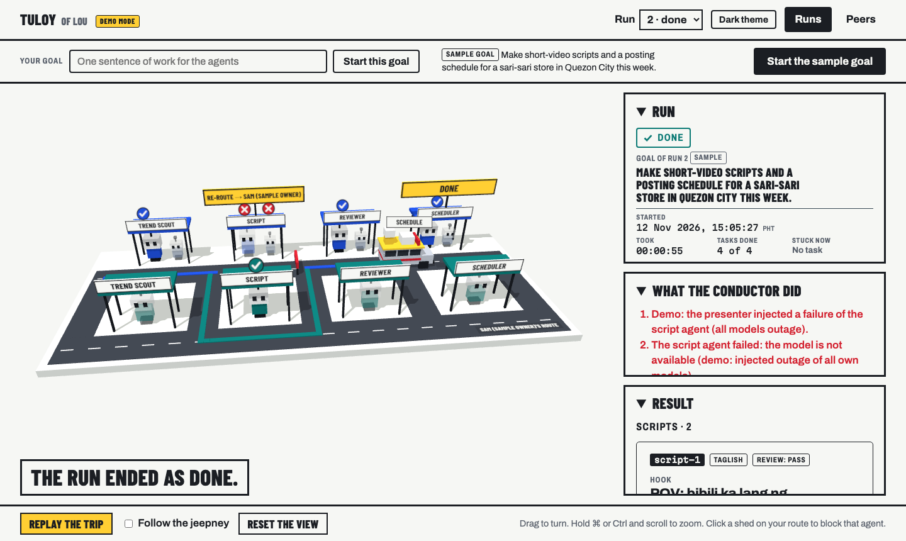
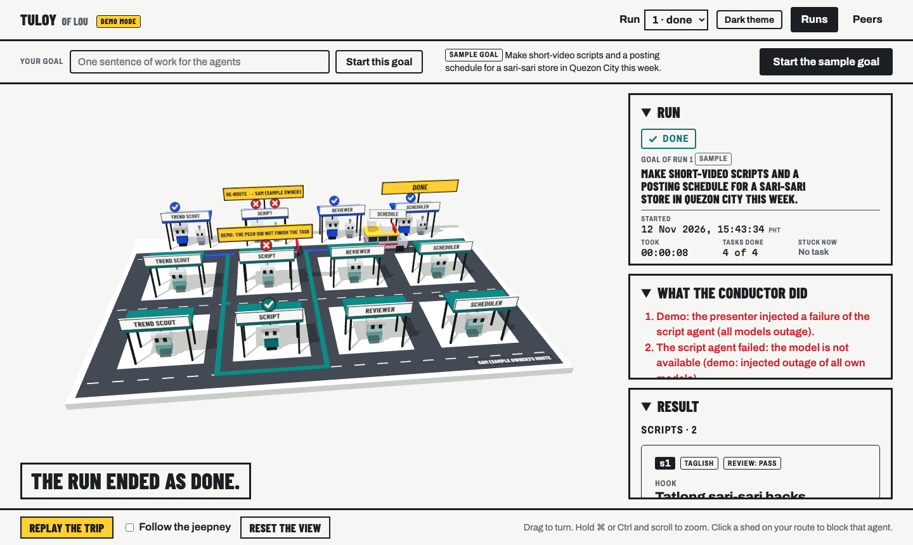

# Tuloy

Tuloy ("keep going") runs a team of AI agents toward a goal and recovers by itself when a task fails. Each owner runs their own Tuloy, and one Tuloy can give work to a peer. The words in this file follow `GLOSSARY.md`.

- Install: `pnpm install`. Test: `pnpm test`. Typecheck: `pnpm typecheck`.
- Start one Tuloy: copy `.env.example` to `.env`, fill in `OPENROUTER_API_KEY`, `TULOY_PRIMARY_MODEL` and `TULOY_BACKUP_MODEL`, then `pnpm start`. The dashboard is at http://localhost:4000.

## The Runs page

The Runs page shows a run as a trip on a 3D street. Your route is the far road. Each peer on your allowed list has its own road, nearer to you. Each agent is a robot at a waiting shed, and a jeepney carries the work from stop to stop. The conductor drives the jeepney. A blocked stop gets a road sign with the stuck reason. When the conductor re-routes a task to a peer, the jeepney goes to the peer's road.

The street fills the window. The other parts lie on top of it: the run, the list "What the conductor did" and the result are in a column on the right, and the sentence at the bottom left says what happens now. Each panel of the column folds: a click on its title closes it or opens it. The result is folded during a run and opens when the run ends. The details (tasks, event trail, past runs) are below the street: scroll down. In a narrow window the parts are below the street.



With two peers, the street has three roads. Here the first peer refused the task, and the second peer did it (scripted model, not a real model):



- Drag to turn the street. Hold ⌘ or Ctrl and scroll to zoom. **Reset the view** puts it back, and **Follow the jeepney** moves the view with the jeepney.
- **Replay the trip** plays an ended run from its start.
- In demo mode, a click on a shed of your route opens the menu of injections for that agent.
- The button in the top bar switches between the light theme and the dark theme. In the light theme the street is a late afternoon. In the dark theme it is a night with street lamps and headlights.
- The houses, the trees and the lamps are scenery. They say nothing about the run.
- The browser must have WebGL. Without it, the page shows the list "What the conductor did" and the result.

## The trend scout can search the web

By default the trend scout proposes trends from the knowledge of the model. With `TULOY_TREND_SEARCH=1` it searches the web with OpenRouter's web search tool, which uses the same key. A search costs money on top of the model call.

- The result shows where the trends came from: "from a web search, N sources" with a link to each page, or "from the model's knowledge, no search".
- Tuloy writes the list of pages from what the search returned. Sources that a model writes by itself are dropped.
- The trend scout then works in two steps, so it makes two model calls: it searches the web and writes notes, then it makes the checked list of trends from the notes. A model that searches answers in plain text, so one call cannot do the two things.
- When the search step fails or finds no page, the trend scout answers from the knowledge of the model, and the result says why. A search that is down does not stop a run.
- Each search returns 5 results at most. Tuloy sends OpenRouter's limits with the tool: 3 searches for one call (`max_uses`) and 15 results in all. The instruction says the same. With a model's own search, OpenRouter passes `max_uses` on to Anthropic only, so for other models the instruction and the time limit of the task are the limits.
- Text from a web page is data for the model, not instructions.

## Run two Tuloys on one laptop

This is the demo path: the owner's own models go down, and the conductor re-routes the script task to a peer. The second Tuloy is a sample owner, not a second person.

A run with real models costs credits. To do the same steps with no real model, see "With the scripted model" below.

1. Start the two Tuloys, each in its own terminal. Both read the same `.env`.

   ```sh
   pnpm start:demo      # your Tuloy:          http://localhost:4000
   pnpm start:sample    # Sam (sample owner):  http://localhost:4001, data in ./data/sample
   ```

   The two commands turn on demo mode (`TULOY_DEMO=1`, for injections) and the same-machine setting (`TULOY_PEER_ALLOW_LOCAL=1`, which permits a peer at a plain-http address on this laptop). `pnpm start` has both off, and then a re-route to a Tuloy on the same laptop is refused.

2. Make an invite. Open http://localhost:4000/peers, select **Make an invite link**, then **Copy the link**.

3. Accept the invite. Open http://localhost:4001/peers, paste the link into **Invite link from another owner**, and select **Accept the invite**. Each Tuloy is now on the allowed list of the other.

4. Inject the outage. On http://localhost:4000, in the **Demo / Injections** panel, keep **Agent to fail** on `script` and select **Outage of all own models**.

5. Start a goal: select **Start the sample goal** (or type a goal and select **Start this goal**).

6. See the re-route. The event trail of the task "Write scripts" shows the outage, then `reroute` to the backup model, then `reroute` to `Sam (sample owner)'s script agent`. The run ends as done with the scripts and the posting schedule. On http://localhost:4001 there is a run with the label "for" and your owner name.

7. To see the last step of the recovery order, inject two failures for `script` before you start a goal: **Outage of all own models** and **Peer refuses**. The peer's script agent then refuses, and the conductor gives the full goal to the peer, one time. The task graph of the run becomes one task, "Give the full goal to Sam (sample owner)", and the peer's dashboard shows a full run of four tasks for you. If that peer run fails too, your run ends as escalated, and the stuck reason names every path that was tried.

### With the scripted model

`node tests/harness/two-fake-tuloys.ts` starts the same two Tuloys on ports 4100 and 4101 with the scripted model, in memory, with the two settings on. Do steps 2 to 7 with these ports. The same steps from a terminal:

```sh
LINK=$(curl -s -X POST http://127.0.0.1:4100/api/invites | node -pe 'JSON.parse(require("fs").readFileSync(0)).link')
curl -s -X POST http://127.0.0.1:4101/api/invites/accept -d "{\"link\":\"$LINK\"}"
curl -s -X POST http://127.0.0.1:4100/api/injections -d '{"task":"script","kind":"all_models_outage"}'
curl -s -X POST http://127.0.0.1:4100/api/runs          # empty body = the sample goal
curl -s http://127.0.0.1:4100/api/runs/1                # the tasks and the event trail
curl -s http://127.0.0.1:4101/api/runs                  # the run "forPeer"
```

For step 7, send a second injection before the run: `-d '{"task":"script","kind":"peer_refuses"}'`.

An injection waits until an attempt of that agent uses it, in a run of the owner (never in a run for a peer). To clear the injections that wait: **Clear the waiting injections** in the demo panel, or `curl -s -X DELETE http://127.0.0.1:4100/api/injections`.

## Unattended runs

- On a Mac, start Tuloy with `caffeinate -i pnpm start`, so that the machine does not sleep in the middle of a run. A sleep shows in the run as a stall of some minutes.
- Each model call has a limit on its output tokens (`TULOY_MAX_OUTPUT_TOKENS`, default 4000). An answer that reaches the limit is cut, and the event says so: "The answer was cut at the limit of 4000 output tokens." Raise the setting if you see that sentence.

## Who can call a Tuloy

- Tuloy listens on `127.0.0.1` (this machine only). Set `TULOY_HOST` (for example `0.0.0.0`) to serve other machines.
- The page and its API have no login. Every call to the page, its API and the live events, a read included, is refused with 403 unless its `Host` header is `localhost` or `127.0.0.1` with the port, or the `TULOY_HOST` value with the port, and its `Origin`, when a browser sends one, is that same address. So open the dashboard by one of these names. The agent card and an invite link are open to everybody.
- The A2A endpoint (`/a2a`) takes work only with a key from the allowed list. An invite link and the agent card of a peer must be `https` and not at a private address, unless `TULOY_PEER_ALLOW_LOCAL=1` (this machine only, plain http).
- While a Tuloy has work for a peer, it tells that peer which of its agents works and which are done (the role and the state, as JSON text in the A2A working status: `{ "tuloy_progress": [{ "role", "state" }] }`). It sends no output, no reason and no model name before the result. The Tuloy that gets this progress checks it as outside data and drops all that does not match.
- A numeric setting that is not a whole number in its range stops the start, with a message that names the setting.
